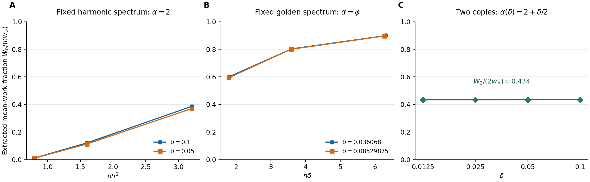

# Quantum Work Activation

## How many systems must be controlled together to recover useful work?

A passive quantum state cannot release work under cyclic driving on one copy. Several copies can release work, but the first active block can exploit only extremely unlikely configurations. This project asks how large a jointly controlled block must be to recover a fixed fraction of the available **average work** as a passive state approaches thermal equilibrium.

For the three-level family

```math
H_\alpha=\operatorname{diag}(0,1,\alpha),\qquad
\rho_{\delta,\alpha}\propto
e^{-\beta H_\alpha+\delta\operatorname{diag}(0,0,1)},
\qquad \delta\downarrow0^+,
```
the available work per copy is proportional to $`\delta^2`$. Nevertheless, the required block size has a different exponent for rational and generic irrational level spacings. The main result applies to **every fixed recovered fraction $`0<f\le1/3`$**.

| Fixed spectrum | Bounds on the minimum block $`N_f`$ | Logarithmic exponent |
|---|---|---|
| Rational $`\alpha>1`$ | $`c/[\delta^2\log(1/\delta)]\le N_f\le C/\delta^2`$ | 2 |
| Irrationality exponent two; includes almost every fixed $`\alpha`$ | $`N_f=\delta^{-1+o(1)}`$ | 1 |
| Badly approximable $`\alpha`$, including quadratic irrationals | $`c/[\delta\log(1/\delta)]\le N_f\le C/\delta`$ | 1 |

Here $`N_f`$ is the smallest number of copies on which one unitary can extract at least $`f`$ times that block's asymptotic work benchmark. The constants depend on the fixed spectrum, inverse temperature and fraction. The logarithmic gaps are part of the stated result. The [model and main theorem](science/model.md) give the full quantifiers.

The exponent-one result also holds uniformly in the calibration window

```math
|\widetilde\alpha-\alpha|\le\frac{\delta}{8\beta},
```
around a nominal irrationality-exponent-two spectrum, provided the input is the specified Gibbs tilt of the **actual** Hamiltonian. One nominally chosen permutation works throughout this window. The [calibration theorem and harmonic counterexample](science/calibration.md) explain both the guarantee and its boundary.

## Scientific account

Start with the [scientific guide](science/README.md). The proof is organized by its mathematical and physical dependencies:

| Topic | Content |
|---|---|
| [Model and main results](science/model.md) | State family, allowed operations, resource, assumptions and complete theorem |
| [Thermodynamic scale](science/thermodynamic_scale.md) | Equal-entropy Gibbs benchmark and its explicit quadratic coefficient |
| [First activation](science/activation.md) | Exact inversion criterion and why first positive work occurs sooner |
| [Achievability](science/achievability.md) | Exact type swaps, uniform Gaussian overlap and the one-third guarantee |
| [All-unitary converses](science/converses.md) | Passive approximations and finite bounds that cover the optimum |
| [Calibration](science/calibration.md) | A uniform uncertainty window and exact two-copy resonant boundaries |
| [Physical interpretation](science/interpretation.md) | Mechanism, mean-work fluctuations, resource accounting and open limits |
| [Related work](references/RELATED_WORK.md) | What is inherited and how the joint-limit result differs from the closest results |

Ergotropy, activation of nonthermal passive states, the equal-entropy Gibbs endpoint, collective extraction of a prescribed work fraction, and arithmetic effects in finite-size thermodynamics are established ideas. The contribution here is the specified **minimum-batch law in the joint near-equilibrium limit**, with explicit constructive recovery, all-unitary converses and a calibrated uncertainty statement. See the [primary-source comparison](references/RELATED_WORK.md) and [structured bibliography](references/references.bib).

## Numerical checks and reproduction



The ordinate is the full unitary ergotropy divided by its asymptotic value. The harmonic cases compare matching $`n\delta^2`$. The golden-ratio cases compare two selected, corresponding continued-fraction windows at matching $`n\delta`$; no universal smooth crossover is inferred. The detuned spectrum changes with $`\delta`$ and is a separate limit. Lines join computed points. See the [complete caption](verification/figures_caption.md) and [numerical report](verification/report.md).

The calculation sorts the complete spectrum using exact integer multiplicities and certified orderings. Probabilities and work are numerical approximations. The supplied suite includes 28 checks against definition-level enumeration, thermal inputs and strict activation boundaries, plus 16 finite-size cases. These calculations support the proof's consistency and do not replace the analytic arguments.

From the repository root, with Python 3.11 or later, NumPy and Matplotlib installed:

```bash
python verification/ergotropy.py all --output-dir verification/data
python verification/plot_results.py
```

The [verification guide](verification/README.md) documents dependencies, arithmetic guarantees, rounding limitations and individual-case commands. The figure can also be downloaded as [PDF](verification/figures/work_scaling.pdf).

## Scope

The charged resource is the number of systems jointly controlled in one block. The state and Hamiltonian are supplied and known; the extraction uses a prescribed cyclic unitary with no bath, catalyst, discarded ancilla or feedback. Gate synthesis, duration, controller cost and reliable work over repeated batches require additional models. In particular, the faster mean-work block scaling does not establish a reduction in the total specimens needed for a reliable output. Recovery fractions above one third and removal of the logarithmic gaps remain outside the proved claim.

## Contact

This repository serves as a record of the work and a guide for the author’s self-directed learning. For discussion or potential collaboration, please contact Ruge Lin at [gogoko699@gmail.com](mailto:gogoko699@gmail.com).
